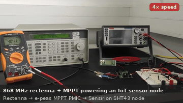
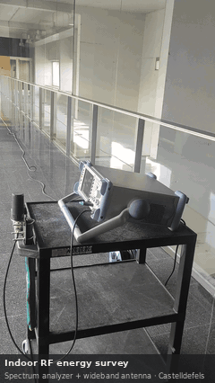
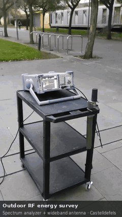
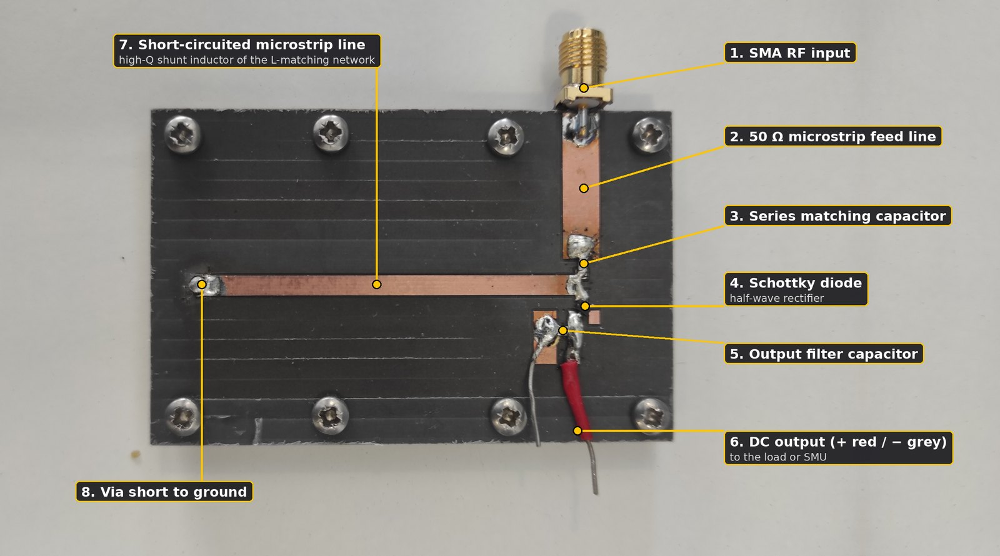
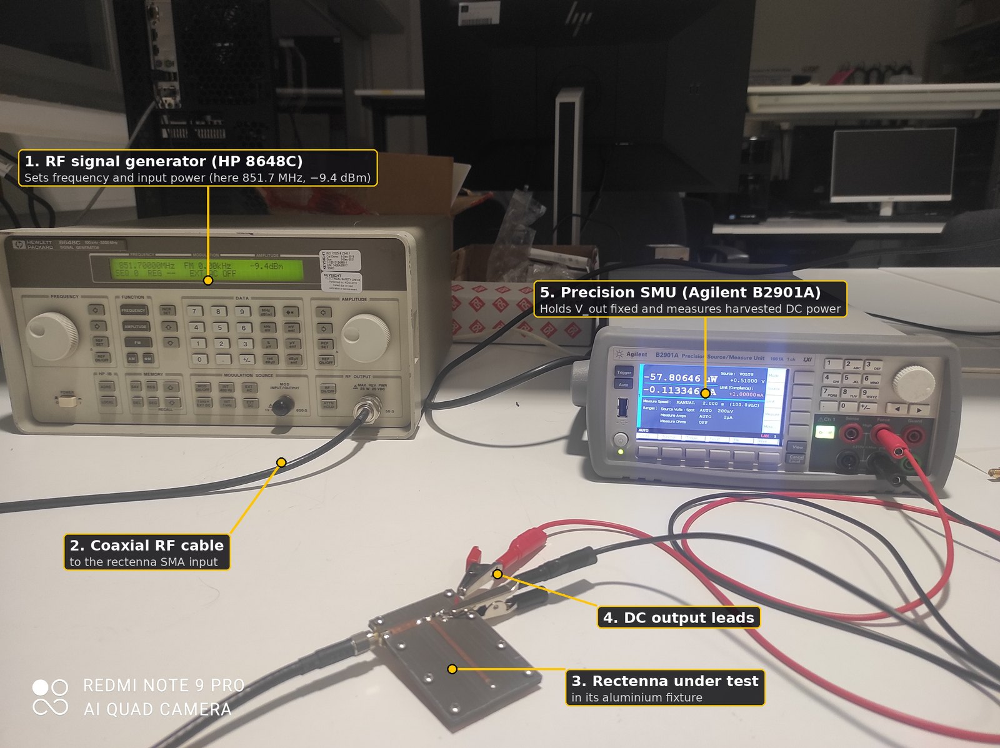
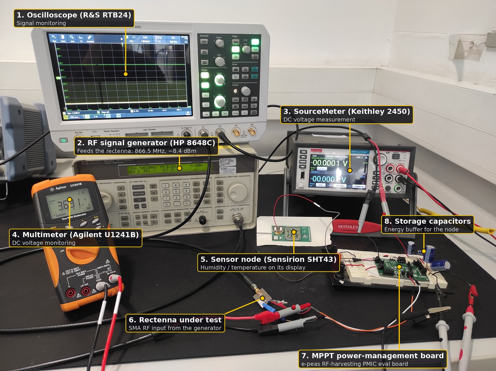

# RF Energy Harvesting (Rectenna)

Rectenna prototypes for RF energy harvesting in the 868 MHz UHF band, developed for battery-free IoT sensor nodes and UHF RFID read-range enhancement. The rectifier uses an L-matching network built from a series capacitor and a high-Q short-circuited microstrip line, followed by a Schottky half-wave rectifier. This repository collects demo videos, RF energy surveys and labeled photos of the fabricated prototypes and measurement setups.

## Demo videos

### Powering a sensor node

<table>
<tr>
<td align="center" width="100%"><a href="Media/rectenna_sensor_node_demo.mp4"></a><br><b>868 MHz rectenna + MPPT powering an IoT sensor node</b><br><sub>An RF signal generator feeds the rectenna; its DC output goes through an e-peas MPPT power-management board into storage capacitors, which power a Sensirion SHT43 humidity/temperature node (GIF at 4× speed).</sub><br><sub><a href="Media/rectenna_sensor_node_demo.mp4">▶ Full video with sound (MP4)</a></sub></td>
</tr>
</table>

### RF energy survey (Castelldefels)

Before designing a harvester, the available ambient RF power has to be known. These surveys scan the spectrum from 150 MHz to 6 GHz with a Rohde & Schwarz FSL spectrum analyzer and a wideband antenna mounted on a mobile cart, measuring the field strength (dBµV/m) of the ambient sources (cellular, Wi-Fi, etc.) at several positions indoors and outdoors on the UPC campus in Castelldefels.

<table>
<tr>
<td align="center" width="50%"><a href="Media/rf_survey_indoor.mp4"></a><br><b>Indoor RF energy survey</b><br><sub><a href="Media/rf_survey_indoor.mp4">▶ Full video with sound (MP4)</a></sub></td>
<td align="center" width="50%"><a href="Media/rf_survey_outdoor.mp4"></a><br><b>Outdoor RF energy survey</b><br><sub><a href="Media/rf_survey_outdoor.mp4">▶ Full video with sound (MP4)</a></sub></td>
</tr>
</table>

## Gallery

### Fabricated prototype

<table>
<tr><td align="center"><a href="Media/rectenna_microstrip_prototype_labeled.jpg"></a><br><b>Rectenna prototype with a microstrip transmission-line matching network</b></td></tr>
</table>

The RF signal enters through the SMA connector and a 50 Ω microstrip feed line. A series capacitor and a short-circuited microstrip line, grounded through a via, form the L-matching network; the line acts as a high-Q shunt inductor that also gives the diode a DC return path. A Schottky diode rectifies the signal (half-wave), and an output capacitor filters the DC delivered to the load. The board is mounted on an aluminium fixture that serves as the ground plane.

### Measurement setups

<table>
<tr>
<td align="center" width="50%"><a href="Media/rectenna_efficiency_measurement_labeled.jpg"></a><br><b>RF-to-DC efficiency measurement</b></td>
<td align="center" width="50%"><a href="Media/rectenna_mppt_sensor_node_setup.jpg"></a><br><b>Powering a sensor node with the rectenna and MPPT</b></td>
</tr>
<tr>
<td valign="top">An HP 8648C signal generator sets the frequency and input power, and an Agilent B2901A precision SMU holds the rectenna output at a fixed voltage while measuring the harvested DC power. The efficiency is the ratio of DC output power to RF input power, swept over frequency, input power and load voltage.</td>
<td valign="top">The complete harvesting chain: the rectenna output feeds an e-peas MPPT power-management board that charges storage capacitors and powers a Sensirion SHT43 sensor node. An oscilloscope, a Keithley 2450 SourceMeter and a multimeter monitor the voltages during operation.</td>
</tr>
</table>

## Related publications

- "Rectenna with a High Quality-Factor Short-Circuited Transmission Line", IEEE SAS 2024.
- "RF Energy Harvesting for IoT Sensors: Effects of Inductor Quality Factor on Efficiency", IEEE I2MTC 2024.

## Folder structure

```
RF-Energy-Harvesting-Rectenna/
└── Media/ (demo videos, RF survey videos, GIFs and labeled prototype photos)
```

See also: [Wireless-Power-Transfer](https://github.com/fereshtianamir-lab/Wireless-Power-Transfer) – magnetic-resonance WPT coils in HFSS, and [RF-Antenna](https://github.com/fereshtianamir-lab/RF-Antenna) – antenna and transmission-line models in HFSS, CST and FEKO.
